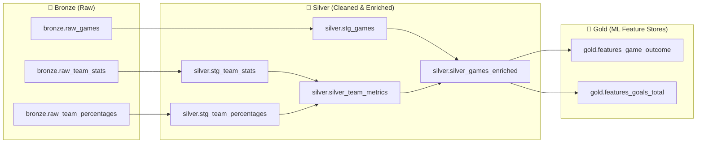

# dbt Medallion Pipeline - Bytebuddies NHL Predictor

This dbt project transforms raw NHL API data into clean, enriched ML feature stores using DuckDB and the Medallion architecture (Bronze -> Silver -> Gold).

---

## 🏛️ Architecture Overview



---

## 📂 Layer Details

### 🥉 Bronze Layer (`bronze`)
- Ingested directly from official NHL APIs using Polars into DuckDB (`src/bronze_ingestion.py`).
- Sources defined in [sources.yml](file:///C:/Users/kompl/code/2026/Projektir2/dbt_project/models/sources.yml).
- Raw tables: `raw_games`, `raw_team_stats`, `raw_team_percentages`.

### 🥈 Silver Layer (`silver`)
- **[stg_games.sql](file:///C:/Users/kompl/code/2026/Projektir2/dbt_project/models/silver/stg_games.sql)**: Deduplicated and typed matches (`game_date` as `DATE`, `is_played`, `home_win`, `away_win`, `total_goals`, `goal_diff`, `is_overtime`).
- **[stg_team_stats.sql](file:///C:/Users/kompl/code/2026/Projektir2/dbt_project/models/silver/stg_team_stats.sql)**: Deduplicated and formatted team season averages (points, goals for/against, PP%, PK%, shots).
- **[stg_team_percentages.sql](file:///C:/Users/kompl/code/2026/Projektir2/dbt_project/models/silver/stg_team_percentages.sql)**: Advanced metrics: Corsi (`sat_pct`), Fenwick (`usat_pct`), PDO (`5v5`).
- **[silver_team_metrics.sql](file:///C:/Users/kompl/code/2026/Projektir2/dbt_project/models/silver/silver_team_metrics.sql)**: Combined team summary with basic and advanced metrics per season.
- **[silver_games_enriched.sql](file:///C:/Users/kompl/code/2026/Projektir2/dbt_project/models/silver/silver_games_enriched.sql)**: Match-level enrichment:
  - Matchup team metrics (Home & Away stats joined).
  - Rest days and Back-to-Back (`is_b2b_home`, `is_b2b_away`) tracking.
  - Rolling 5 & 10 game form (win rate, goals scored, goals allowed) prior to each match (no data leakage).

### 🥇 Gold Layer (`gold`)
- **[features_game_outcome.sql](file:///C:/Users/kompl/code/2026/Projektir2/dbt_project/models/gold/features_game_outcome.sql)**:
  - **Task**: Game winner prediction (classification: `target_home_win`).
  - **Features**: Rest differential, rolling form differentials, seasonal point percentage differential, Corsi/Fenwick differentials, PDO differentials, and special teams differential.
- **[features_goals_total.sql](file:///C:/Users/kompl/code/2026/Projektir2/dbt_project/models/gold/features_goals_total.sql)**:
  - **Task**: Goals prediction (regression: `target_total_goals`, classification: `target_over_5_5`, `target_over_6_5`).
  - **Features**: Combined scoring and allowed averages, rolling 5/10 scoring trends, combined shot volumes, combined power play and penalty kill vulnerabilities.

---

## 🚀 Running the Pipeline

From the `dbt_project` directory:

```bash
# Verify connection
uv run dbt debug

# Run all models
uv run dbt run

# Run schema and data quality tests
uv run dbt test

# Generate and view interactive documentation
uv run dbt docs generate
uv run dbt docs serve
```
