# Dataputken Sukupuu (Lineage) ja Arkkitehtuurianalyysi

Tämä dokumentti esittelee Bytebuddies NHL Predictor -projektin dbt Medallion -dataputken riippuvuussuhteet (`ref()` ja `source()`), suunnitteluperiaatteet, kriittisen arvioinnin ja kehityskohteet opintojakson arviointikriteeristön mukaisesti.

---

## 1. Datan Sukupuu (Lineage-kaavio)

```mermaid
graph LR
    %% Lähteet (NHL API)
    subgraph Ingestion ["NHL API Tiedonkeruu (Python / Polars)"]
        API1["api-web.nhle.com/v1<br>(Otteluohjelmat ja tulokset)"]
        API2["api.nhle.com/stats/rest<br>(Kausitilastot)"]
        API3["api.nhle.com/stats/rest<br>(Corsi, Fenwick, PDO)"]
    end

    %% DuckDB Raw Sources
    subgraph Sources ["DuckDB Raw -taulut"]
        raw_games["source('bronze', 'raw_games')"]
        raw_team_stats["source('bronze', 'raw_team_stats')"]
        raw_team_percentages["source('bronze', 'raw_team_percentages')"]
    end

    %% Bronze
    subgraph Bronze ["🥉 Bronze - Raakamallit (dbt)"]
        bronze_games["bronze_games<br/>(Alkuperäinen otteludata)"]
        bronze_team_stats["bronze_team_stats<br/>(Alkuperäiset kausitilastot)"]
        bronze_team_percentages["bronze_team_percentages<br/>(Alkuperäiset Corsi/Fenwick/PDO)"]
    end

    %% Silver
    subgraph Silver ["🥈 Silver - Puhdistus ja piirrerikastus"]
        stg_games["stg_games<br/>(Tyypitys, tulosliput, deduplikointi)"]
        stg_team_stats["stg_team_stats<br/>(Kausitilastojen siivous)"]
        stg_team_percentages["stg_team_percentages<br/>(Kehittyneiden tilastojen siivous)"]
        silver_team_lineage["silver_team_lineage<br/>(Virallinen team_id -> lineage_id)"]
        silver_team_metrics["silver_team_metrics<br/>(Yhdistetty joukkueprofiili)"]
        silver_games_enriched["silver_games_enriched<br/>(Lepopäivät & rolling 5/10 kuntopuntari)"]
    end

    %% Gold
    subgraph Gold ["🥇 Gold - ML-syötekerros"]
        gold_games["gold_games<br/>(Analyysi- ja koneoppimisvalmis taulu)"]
    end

    %% API Ingestion -> Raw
    API1 -->|Ingestion| raw_games
    API2 -->|Ingestion| raw_team_stats
    API3 -->|Ingestion| raw_team_percentages

    %% Raw -> Bronze Models
    raw_games -->|source| bronze_games
    raw_team_stats -->|source| bronze_team_stats
    raw_team_percentages -->|source| bronze_team_percentages

    %% Bronze -> Silver Staging
    bronze_games -->|ref| stg_games
    bronze_team_stats -->|ref| stg_team_stats
    bronze_team_percentages -->|ref| stg_team_percentages

    %% Silver Joins & Transforms
    stg_team_stats -->|ref| silver_team_lineage
    stg_team_stats -->|ref| silver_team_metrics
    stg_team_percentages -->|ref| silver_team_metrics
    silver_team_lineage -->|ref| silver_team_metrics

    stg_games -->|ref| silver_games_enriched
    silver_team_metrics -->|ref| silver_games_enriched
    silver_team_lineage -->|ref| silver_games_enriched

    %% Silver -> Gold
    silver_games_enriched -->|ref| gold_games
```



---

## 2. Miksi on tehty näin? (Arkkitehtuuriset suunnitteluvalinnat)

### 2.1 Medallion-arkkitehtuurin (Bronze–Silver–Gold) valinta
1. **Laadunhallinnan ja vastuun eriyttäminen:**
   - **Bronze** (`models/bronze/`): Paketoi API-lähteistä haetun raakadatan virallisiksi dbt-malleiksi säilyttäen alkuperäiset sarakkeet ja JSON-vastaukset. Jos muunnoslogiikka muuttuu, koko putki voidaan ajaa uudelleen ilman hitaita API-kutsuja.
   - **Silver** (`models/silver/`): Poistaa kohinan, muuntaa päivämäärät ja tyypit sekä tuottaa standardoidun liiketoimintalogiikan (esim. kotivoitto, jatkoaika, maalimäärät, lepopäivät ja kuntopuntarit).
   - **Gold** (`models/gold/`): Kokoaa puhtaan, yhdenmukaisen aineiston (`gold_games`) ML-vaihetta varten, jolloin koneoppimismallia kehittävä tiimiläinen ei joudu kirjoittamaan SQL-liitoksia tai datawrangling-koodia Pythonissa.

### 2.2 Tulosliput (Result Flags) ja niiden standardointi
NHL-rajapinnan data sisältää raakatietoja eri formaateissa (`gameState: "FINAL"`, `"OFF"`, `"FUT"`). Hopeatasolla muodostetaan standardoidut loogiset ja numeeriset tulosliput:
- **`is_played` (TRUE/FALSE):** Erottelee pelatut ottelut tulevista otteluista, joissa tulokset ovat vielä tyhjiä (`NULL`). Estää tulevien otteluiden vuotamisen opetusdataan.
- **`home_win` / `away_win` (1 tai 0):** Yksiselitteinen numeerinen tulosmuuttuja. `home_win` toimii koneoppimisessa luokittelun keskeisenä ennustekohteena (*Target variable*).
- **`is_overtime` ja `is_regulation`:** Tunnistaa, ratkesiko peli varsinaisella peliajalla vai jatkoajalla/voittomaalikilpailussa, mikä on jääkiekon pistelaskussa ja todennäköisyyksissä olennainen tieto.

### 2.3 Datavuodon (Data Leakage) esto ikkunafunktioilla
- Koneoppimisessa yksi vakavimmista virheistä urheiludatan ennustamisessa on **datavuoto**: mallille syötetään piirteitä, jotka sisältävät tietoa tulevaisuudesta tai kyseisen ottelun omasta lopputuloksesta.
- **Ratkaisu:** Kuntopuntaria (rolling 5 & 10 games voittoprosentti, tehdyt ja päästetyt maalit) laskettaessa käytettiin SQL-ikkunamääritystä:
  ```sql
  ROWS BETWEEN 5 PRECEDING AND 1 PRECEDING
  ```
  Tämä takaa matemaattisen varmuuden siitä, että ikkuna päättyy tarkalleen yhteen otteluun ennen kyseistä peliä (`1 PRECEDING`), jolloin ennustettavan ottelun (`CURRENT ROW`) tapahtumia ei oteta mukaan omien piirteidensä laskentaan. Ennustehetkellä käytetään vain sitä tietoa, joka oli saatavilla ennen pelin alkua.

### 2.4 Lepopäivät ja rasitustekijät
Ikkunafunktioilla lasketaan joukkueiden edellisen pelin päivämäärä ja siitä lepopäivien määrä:
```sql
date_diff('day', LAG(game_date) OVER (...), game_date) AS days_rest
```
Jos lepopäiviä on tasan 1, kyseessä on peräkkäisinä päivinä pelaaminen (*back-to-back*, `is_b2b = 1`), mikä nostaa väsymys- ja matkustusrasitusta.

### 2.5 DuckDB sulautettuna analyysitietokantana
- **Perustelu:** DuckDB on sarakeorientoitunut (columnar) OLAP-kanta, joka suorittaa analyyttiset kyselyt, aggregoinnit ja ikkunafunktiot huomattavasti nopeammin kuin SQLite tai Pandas. Se toimii paikallisesti ilman erillistä palvelinta, jolloin jokainen tiimin jäsen voi ajaa koodia suoraan omalta koneeltaan ilman Docker- tai pilvikonfiguraatioita.

### 2.6 Joukkuejatkuvuus (franchise-lineage) ja ARI → UTA
- NHL:n virallinen `team_id` ei aina vastaa joukkueen todellista jatkuvuutta. Arizona Coyotes pelasi `team_id`-tunnuksella 53, kun taas Utah Hockey Club (2024-25) ja Utah Mammoth (2025-26+) käyttävät `team_id`-tunnusta 59.
- Utah peri Arizonan hockey operations -toiminnot, joten prior-kauden vertailuluvut (esim. edellisen kauden Corsi ja PDO) kuuluvat laskea saman joukkuejatkumon sisällä. Ilman tätä Utahin ensimmäisen kauden kaikki prior-piirteet jäisivät `NULL`-arvoiksi.
- **Ratkaisu:** `silver_team_lineage` muodostaa yhden rivin jokaista virallista `team_id`-tunnusta kohden ja lisää synteettisen `lineage_id`-avaimen. Malli mappaa Arizonan (53) ja Utahin (59) arvoon 53. Virallisia tunnisteita (`team_id`, `team_abbrev`, `team_name`) ei korvata, vaan ne säilyvät Gold-taulussa auditointia ja raportointia varten.
- `silver_games_enriched` liittää prior-kauden metriikat avaimella `(season - 10001, lineage_id)`, jolloin ARI 2023-24 toimii UTA 2024-25:n baseline-na. Koska Utahin `team_id` 59 pysyy samana myös kaudella 2025-26 (Utah Mammoth), rebrand ei vaadi uutta ingestiota eikä nimeen perustuvaa liitosta.
- `lineage_id` on vain liitos- ja auditointiavain, ei koneoppimispiirre. Testit varmistavat, ettei `(season, lineage_id)` vastaa useampaa virallista joukkuetta, että prior-metriikat eivät jää `NULL`-arvoiksi silloin kun edellisen kauden data on olemassa, ja että UTA 2024-25:n baseline vastaa ARI 2023-24:n riviä.

---

## 3. Mikä toteutuksessa on hyvää? (Vahvuudet)

1. **Nopeus ja keveys:**
   - Koko kauden (1 504 ottelua ja 32 joukkueen metriikat) dbt-ajaminen (kaikki 10 taulua) vie DuckDB:llä vain **noin 1 sekunnin** (`1.08s`).
2. **Automaattinen laadunvarmistus (Data Testing):**
   - Projektissa on 47 automaattista dbt-testiä, jotka kattavat Bronze-, Silver- ja Gold-kerrokset. Ne varmistavat pääavainten uniikkiuden (`game_id unique`) ja kriittisten kenttien (`not_null`) eheyden jokaisella ajolla.
3. **Yhtenäinen lähde totuudelle (Single Source of Truth):**
   - Jos laskentalogiikkaa (esim. lepopäivien laskentaa tai kuntopuntaria) täytyy säätää, muutos tehdään vain yhteen Silver-tiedostoon, ja uusi logiikka heijastuu suoraan Gold-kerrokseen.
4. **Täysin riippumaton ML-rajapinta:**
   - Gold-tason `gold_games` on suunniteltu neutraaliksi ja kattavaksi. Se ei tee oletuksia käytettävästä ML-algoritmista (logistinen regressio, satunnaismetsä, XGBoost tai neuroverkko), vaan tarjoaa sekä koti- ja vierasjoukkueen tilastot että valmiiksi lasketut differentiaalit (Home vs Away erotukset).

---

## 4. Mikä ei ehkä ole toiminut tai missä oli haasteita? (Kriittinen tarkastelu)

1. **Epävirallisen NHL API:n muuttuvuus ja rajoitukset:**
   - NHL sulki vanhan tilastorajapintansa (`statsapi.web.nhl.com`) ilman ennakkovaroitusta syksyllä 2023. Uusi API (`api-web.nhle.com` ja `api.nhle.com/stats/rest`) on dokumentoimaton ja voi muuttua.
   - **Haaste:** Rajapinnasta puuttuvat loukkaantumistiedot (Injury reports) ja viralliset ketjukokoonpanot ennen ottelua. Tämä rajaa ennustemallin potentiaalista tarkkuutta.
2. **dbt-duckdb skeemojen oletusnimeäminen:**
   - dbt-duckdb nimeää mukautetut skeemat oletuksena muotoon `main_silver` ja `main_gold`. Tämä rikkoi aluksi puhtaan `bronze/silver/gold`-rakenteen.
   - **Ratkaisu:** Ongelma ratkaistiin toteuttamalla makro `generate_schema_name.sql`, joka ohittaa etuliitteen ja ohjaa taulut puhtaasti oikeisiin skeemoihin.
3. **Yksittäisen kirjoittajan rajoitus (DuckDB file lock):**
   - DuckDB tukee samanaikaista rinnakkaista lukemista, mutta vain yksi prosessi voi kirjoittaa kantaan kerrallaan. Jos jokin Marimo-notebook tai Python-istunto pitää yhteyttä auki kirjoitustilassa, `dbt run` epäonnistuu tiedostolukitukseen.
4. **Kausikohtaisten aggregointien rajallisuus aikasarjassa:**
   - Tällä hetkellä `bronze.raw_team_stats` edustaa koko kauden aggregoitua lopputilannetta kyseiseltä kaudelta. Jos halutaan täydellisen tarkka "as-of-date" -sarjataulukko ennen jokaista historiallista ottelua, sarjataulukko tulisi laskea kumulatiivisesti pelatuista otteluista ottelupäivän mukaan.

---

## 5. Mitä voisi mahdollisesti parantaa jatkokehityksessä? (Jatkoaskeleet)

1. **Kumulatiivinen sarjataulukkolaskenta ottelutuloksista:**
   - Lasketaan sarjataulukon pisteet, maalit ja voittoputket suoraan historiallisista ottelutuloksista kunkin päivämäärän kohdalla (`cumulative sum over partition by team, season order by game_date`). Tämä poistaa kausikohtaisten lopputilastojen pienen ennakkotietoharhan.
2. **Pelaaja- ja maalivahtitason rikastus:**
   - Aloittavan maalivahdin torjuntaprosentti (`goalie save percentage`) ja ykköskentän pistekeskiarvot ovat jääkiekossa ratkaisevia muuttujia. Rajapinnasta voitaisiin noutaa maalivahtien tiedot ja liittää ne otteluriville.
3. **Automatisoitu dataputken orkestrointi:**
   - Tällä hetkellä datankeruu ja dbt ajetaan manuaalisesti komentoriviltä. Jatkokehityksessä putki voitaisiin kytkeä esim. GitHub Actionsiin tai kevyeen ajastimeen, joka hakee edellisyön ottelutulokset ja päivittää ennusteet seuraavan päivän peleille automaattisesti.
